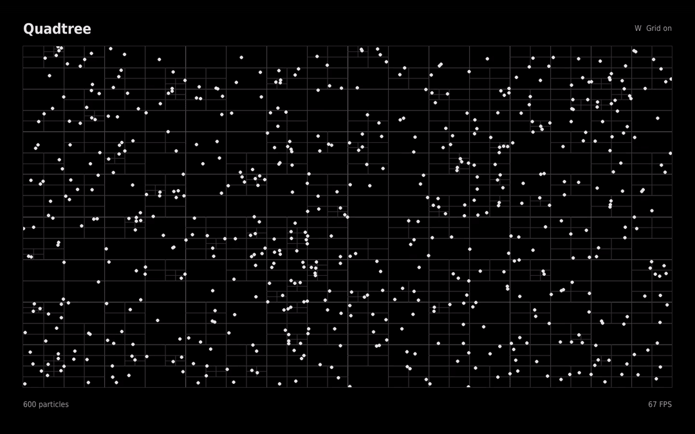

# Quadtree Visualization

A Python and Pygame demo of a quadtree with 600 moving particles. The grid shows how the tree divides space for nearby collision checks.



## Run locally

With [uv](https://docs.astral.sh/uv/) installed, run this from the repository root.

```sh
uv run main.py
```

Press **W** to toggle the grid or **Esc** to quit.

The tree splits a rectangle into four when a node fills up. The demo rebuilds the tree as the particles move and queries nearby nodes for collision candidates.
